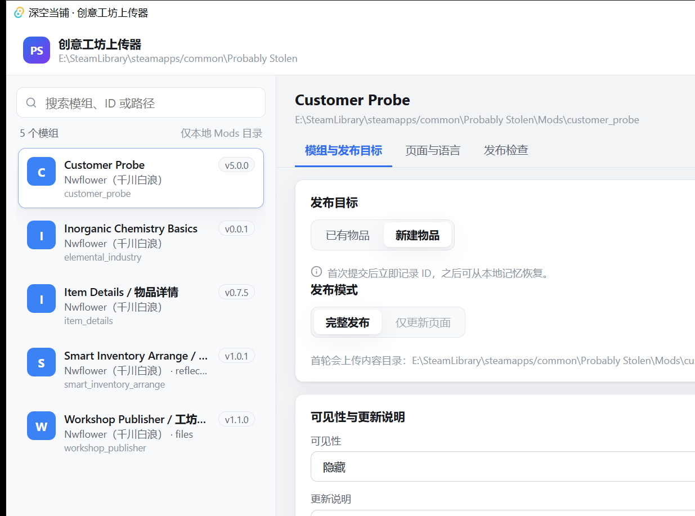

# 深空当铺 · 创意工坊上传器（Rust / Tauri）

用 Rust 重写的《深空当铺 / Probably Stolen》创意工坊上传器。当前版本已经接入真实 Steam
与本地游戏目录：扫描 `<游戏>/Mods`、按游戏加载器判据校验 `manifest.xml`、查询本账号已发布物品、
创建或更新工坊物品并逐语言提交。发布动作只由你在窗口里点击触发。

作者：千川白浪(Nwflower) · 许可：AGPL-3.0-only



## 现在能做什么

- 自动定位 Steam 库与游戏目录，扫描本地 `Mods/`，按名称、ID 或路径搜索
- 按游戏加载器规则校验 `manifest.xml`：ID 字符集、程序集存在且含 IMod 标记、能力名、未声明 DLL
- 编辑工坊页面：多语言标题与描述、TAG、可见性、更新说明
- 自动查询当前账号已发布的物品，按本地记忆或标题匹配目标，也可手动指定 ID
- 在模组列表和编辑区显示 `preview.png` / `preview.jpg` / `preview.jpeg`
- 完整发布或仅更新页面（后者不设置内容目录）
- 分语言逐轮提交，显示进度、已确认语言与“结果未确认”
- 新建物品取得 ID 后写入本地记忆，供下次恢复

## 运行

需要 Windows 10 1809+ / Windows 11 x64、WebView2 运行时，以及两套工具链：

| 工具 | 用途 |
| --- | --- |
| Rust 1.99.1（含 rustfmt、clippy） | 编译原生核心与桌面外壳 |
| Node.js 24 | 构建前端 |
| Visual Studio 2022 Build Tools + C++ x64 组件 | MSVC 链接器 |

```powershell
npm install
pwsh scripts/desktop.ps1 dev                 # 打开桌面窗口
pwsh scripts/desktop.ps1 build --no-bundle   # 产出可执行文件
npm run dev                                  # 只在浏览器里看布局
```

浏览器预览会显示“浏览器预览 · 未运行状态机”徽标。它只渲染界面，不执行 Rust 校验，
也不产生可发布结论。

## 代码结构

```text
crates/uploader-core/   原生 Rust：数据模型、发布计划、校验、轮次、任务状态机
src-tauri/              Tauri 外壳：命令、状态、窗口配置
src/                    React 界面：列表、编辑区、发布检查、操作条
tests/fixtures/         合成演示数据（不是真实账号或存档）
```

校验、保留策略和轮次编排全部在 `uploader-core` 里实现，界面只负责收集输入和展示结果。
前端没有第二套发布逻辑，浏览器预览也不复制这些规则。

## 尚未实现

- 从旧版 C# 上传器一键导入 `workshop-meta.json`（新版直接读同一个文件，未做迁移向导）
- VDF 导入、安装包、签名、自动更新
- 预览图替换按钮（当前读取模组目录里的 `preview.png`）

## 自检

```powershell
.\workshop-uploader.exe --selftest    # 初始化 Steam，报告账号与 AppID
.\workshop-uploader.exe --scanmods    # 只读扫描 Mods 并打印校验结果
```

两个命令都不创建、不修改任何工坊物品。

## 已知限制

- 当前 Rust 预览版在部分 Windows 环境可能因 WebView2 返回 `0x800700AA` 而无法启动；该问题尚未修复。默认 `main` 分支的 C# 版不依赖 WebView2，可作为回退。
- 物品列表查询使用 `query_user`，失败时回退到 `query_all`；实际账号列表与自动匹配仍需人工联调。
  查询不可用时，可在“手动输入 / 核对 ID”中按单个 ID 核对。
- 发布、更新与多语言提交的实现已完成并通过编译，但**尚未做真实上传验证**；
  首次真实提交需要你在界面里手动执行。

## 许可

原创代码使用 [GNU AGPL v3](LICENSE)。第三方依赖的许可与游戏素材归属见
[THIRD-PARTY-NOTICES.md](THIRD-PARTY-NOTICES.md)。
